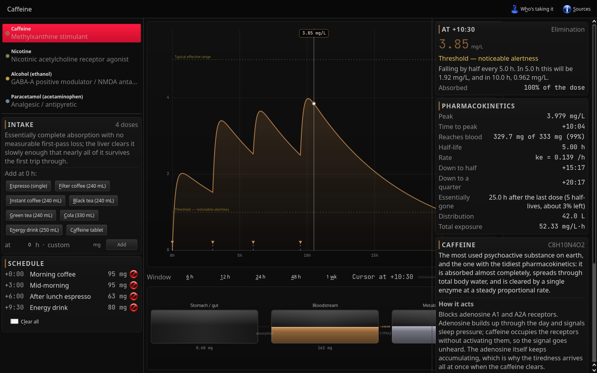
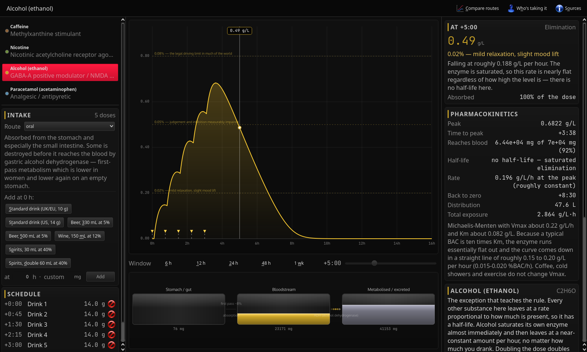

# Kinetics

An app for a question most people never get answered: when you take something,
what actually happens to it? How much of it reaches your blood, how fast, where
it goes, what it turns into, and how long it really takes to leave.



You pick a substance, a route and a dose, stack as many intakes as you like on a
timeline, and it plots the concentration in your blood over time, with the
absorption, peak and elimination phases explained as you move the cursor across
them.

**It is a teaching model, not a clinical tool.** It uses compartmental
pharmacokinetics with population-average parameters from published literature.
It shows you the *shape* of what happens. It cannot tell you what will happen to
any particular person, and it is not a dosing calculator.

## The four substances, and why these four

Each one is here to demonstrate a different principle.

**Caffeine — the textbook case.** Near-complete absorption, a single enzyme, a
clean half-life. The baseline everything else is a departure from. Stack a day
of coffees and watch why the 4 pm espresso is still at a third of its peak at
midnight.

**Nicotine — the route matters more than the dose.** The same 1.2 mg peaks ten
times higher smoked than from a patch. Hit "Compare routes" to see all five on
one plot. This is the pharmacological reason a patch treats dependence and a
cigarette feeds it: the reward system reads the *speed* of the rise, not the
amount. The patch also demonstrates **flip-flop kinetics** — it releases nicotine
more slowly than the body clears it, so the tail of the curve reports the release
rate, not the elimination rate.

**Alcohol — the exception that defines the rule.** Everything else leaves at a
rate proportional to how much is there, which is what a half-life *is*. Alcohol
saturates its enzyme almost immediately and then leaves at a near-constant amount
per hour. Doubling the dose doubles the time. Nothing speeds it up. The straight
decline in the plot is the whole point:



**Paracetamol — a safety margin that is about a pathway, not a dose.** About 8%
goes down a route that produces NAPQI, which is reactive and is neutralised by
glutathione. Glutathione is finite. The metabolite bar under the body diagram
shows the split, and turning on "regular heavy drinking" roughly doubles the
NAPQI share — the best-documented interaction in the set.

## What's in it

- **Concentration curve** with dose markers, labelled effect levels, and a cursor
  that explains the phase you're in at that moment.
- **Body diagram** showing where the substance is right now: gut, bloodstream,
  eliminated, with particles that flow faster when absorption is faster, the
  first-pass loss labelled, and the metabolites it has formed so far.
- **Personal factors** — weight, body-water fraction, smoking, regular drinking,
  oral contraceptives, CYP2A6 metabolizer type. Each is a documented multiplier
  with its reasoning shown, saved to `~/.config/kinetics/person.json`.
- **Sources** for every number, per substance, reachable from the toolbar.

## Accuracy

The model is one-compartment with first-order absorption, or Michaelis-Menten
elimination for alcohol. The test suite checks it against the analytic Bateman
solution, conservation of mass, and published values:

| Check | Result |
|---|---|
| Solver vs. Bateman closed form | within 0.01% |
| Mass conservation | exact to 1e-3 mg |
| Alcohol elimination rate | 0.15–0.20 g/L/h (published range) |
| Alcohol peak vs. Widmark back-extrapolation | within 5% |
| Published Tmax and half-lives round-trip | within 12% |
| Caffeine peak, one 95 mg coffee | 1.5–2.5 mg/L |
| Paracetamol NAPQI fraction | 8% ± 1% |

```
python3 -m unittest -v tests.test_pk
```

## Use

```
./install.sh        # ~/.local/bin/kinetics + menu entry, no root
kinetics
```

Click a substance on the left, add intakes with the preset buttons (set the hour
first), and drag across the plot to move the cursor. The window buttons go from
6 hours to a week.

## Adding a substance

Drop a JSON file in `kinetics/data/` following the shape of the existing four and
add its id to `SUBSTANCE_ORDER` in `kinetics/model.py`. Every value needs an entry
in `sources` saying what it was used for; a test enforces that.
